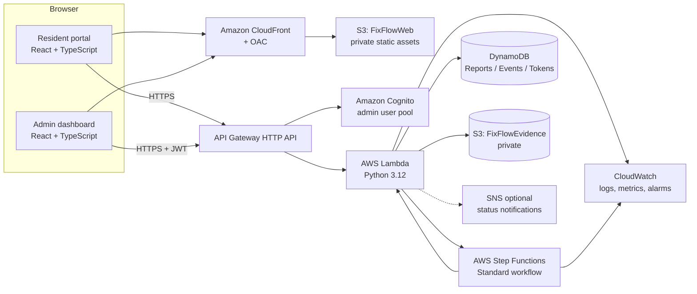

# FixFlow

> From community reports to accountable action.

**Build status: Phase 3, workflow and review slice.** The repository contains the design
documentation, a deployable SAM stack, the DynamoDB tables and private storage, the Cognito
admin pool, a tested `GET /health` endpoint, presigned evidence uploads, transactional
report submission, public tracking with a filtered projection, and a Step Functions workflow
that validates, scores, and waits for an administrator review. The review endpoint requires
a Cognito JWT with the `admin` group, consumes the task token transactionally, and resumes
the workflow. Assignment, resolution, verification, and the frontend are not implemented
yet. Anything described as deployed or measured is a target, not a claim.

FixFlow is a serverless civic infrastructure reporting and resolution platform. Residents
report problems such as potholes, broken streetlights, leaking public water pipes, damaged
drainage, and overflowing waste collection points. Administrators review evidence,
prioritize reports, assign work, and verify submitted resolution evidence.

The product is not another reporting form. It is a lightweight accountability workflow:
a transparent, auditable path from submission to verified resolution.

---

## The problem

Communities already have ways to report infrastructure problems: social media, phone
calls, messaging groups, and informal contacts. Those channels surface issues, but they
usually do not answer the questions that matter after the post is published:

- Was the report received?
- Who reviewed it?
- Is anyone responsible for it?
- Has the work started?
- Was the repair actually verified?

The gap is often not the absence of a reporting channel. It is the absence of a transparent
resolution process.

## The Community Resolution Loop

1. **Report** - A resident submits a description, category, location, and optional photo.
2. **Validate** - The system checks required fields, file type, file size, and evidence ownership.
3. **Prioritize** - A published, deterministic rule set suggests a priority. It is not a safety assessment.
4. **Review** - An authorized administrator approves, rejects, or requests clarification.
5. **Assign** - An approved report is assigned to a responsible maintenance team.
6. **Resolve and verify** - The team submits completion evidence. An administrator verifies it before the report is marked resolved.

Human oversight is deliberate. FixFlow never independently declares an issue verified or
resolved, and it never uses AI to set urgency, approve work, or verify a repair.

## Who it is for

| User | Need |
| --- | --- |
| Residents | Submit an issue, attach evidence, receive a tracking reference, and follow progress. |
| Community representatives | Monitor local issues and identify reports that remain unresolved. |
| Maintenance teams | Receive structured assignments and submit completion evidence. |
| Community organizations and local administrators | Review reports, manage responsibility, and measure resolution performance. |

**Scope boundary:** the initial audience is community organizations and local maintenance
teams. FixFlow does not claim government adoption, formal authority integrations, or
verified community impact unless those relationships and outcomes actually exist.

## MVP scope

The MVP has two dashboards and one complete workflow. The goal is a reliable end-to-end
experience, not a long feature list.

### Resident portal

- Submit a report with category, description, area, and optional coordinates.
- Upload an optional supporting photo directly to private object storage.
- Receive a high-entropy public tracking reference.
- Track status and a limited public timeline.
- Respond to an administrator request for more information.

### Administration dashboard

- View and filter reports by status and category.
- Inspect report details and evidence through short-lived URLs.
- Approve, reject, or request clarification.
- Assign an approved report to a maintenance team.
- Review completion evidence and verify resolution.

### Public accountability

- Look up a report by its public reference.
- See current status and a limited public timeline.
- See a resolution confirmation once an administrator verifies it.
- Never see resident contact details, internal identifiers, raw evidence keys, or private notes.

### Explicitly out of scope for the weekend

- GIS, mapping, routing, or a native mobile application.
- Automatic integration with government systems.
- Payments, advanced notification infrastructure, or multi-organization tenancy.
- Autonomous AI decisions or automatic verification of repairs.
- Any feature that does not strengthen the report-to-resolution journey.

## Architecture at a glance



**Why serverless fits this problem:** the workload is bursty and low-volume, the workflow
is long-running because it waits for human decisions, and the team should not spend the
weekend provisioning, patching, or operating servers. Step Functions gives the human
approval steps a durable, auditable place to wait. DynamoDB and S3 scale to zero when the
demo is idle.

## AWS services

| Service | Role in FixFlow | Notes |
| --- | --- | --- |
| Amazon CloudFront | Delivers the React frontend from a private S3 bucket. | Use Origin Access Control, not legacy OAI. |
| Amazon S3 | Stores static frontend assets and private evidence. | Separate buckets for web and evidence. Block all public access. |
| Amazon API Gateway | HTTP API entry point for public and admin requests. | JWT authorizer on admin routes, CORS restricted to the app origin. |
| AWS Lambda | Validation, business rules, persistence, presigned URLs, workflow callbacks. | Python 3.12, one responsibility per handler. |
| AWS Step Functions | Coordinates validation, priority calculation, review, assignment, resolution, and verification. | Standard workflow because Express workflows cannot wait for a task token. |
| Amazon DynamoDB | Stores reports, append-only audit events, and short-lived workflow task tokens. | On-demand capacity for the initial workload. |
| Amazon Cognito | Authenticates administrators and carries the `admin` group. | Self-signup disabled; users are provisioned by an operator. |
| Amazon SNS (optional) | Sends status notifications after the core workflow is stable. | Not in the critical path. |
| Amazon CloudWatch | Logs, metrics, alarms, and dashboards. | Structured JSON logs; never log tokens or PII. |

## Repository layout (planned)

```text
fixflow/
├── frontend/
│   ├── src/
│   │   ├── components/
│   │   ├── pages/
│   │   ├── features/
│   │   │   ├── reports/
│   │   │   ├── dashboard/
│   │   │   └── tracking/
│   │   ├── services/
│   │   ├── types/
│   │   └── main.tsx
│   └── package.json
├── backend/
│   ├── functions/
│   │   ├── create_upload_url/
│   │   ├── submit_report/
│   │   ├── get_public_report/
│   │   ├── get_public_events/
│   │   ├── respond_clarification/
│   │   ├── get_reports/
│   │   ├── get_report/
│   │   ├── review_report/
│   │   ├── assign_report/
│   │   ├── create_resolution_upload_url/
│   │   ├── submit_resolution/
│   │   ├── verify_resolution/
│   │   ├── get_metrics/
│   │   ├── validate_report/
│   │   ├── calculate_priority/
│   │   ├── transition_report/
│   │   ├── store_task_token/
│   │   └── record_workflow_failure/
│   ├── shared/
│   └── statemachines/
│       └── report_workflow.asl.json
├── infrastructure/
│   └── template.yaml
├── docs/
│   ├── architecture.md
│   ├── api.md
│   ├── data-model.md
│   ├── security.md
│   └── screenshots/
├── scripts/
│   ├── seed_demo_data.py
│   └── cleanup.sh
├── README.md
└── .gitignore
```

The SAM template is the source of truth for infrastructure. Do not create production
resources manually in the console when they can be defined and reproduced in code.

## Local development

**Prerequisites:** Node.js 20+, Python 3.12+, `uv`, AWS SAM CLI, AWS CLI v2, and an AWS
account with credentials configured for the target region.

```bash
# Install backend dependencies
make install

# Run unit tests and offline checks
make test
make check

# Validate the SAM template (requires the SAM CLI)
make sam-validate

# Build and deploy the backend
make build
make deploy STACK_NAME=fixflow REGION=us-east-1 STAGE=dev \
  ALLOWED_ORIGIN=http://localhost:5173 WEB_URL=http://localhost:5173
```

`make help` lists every target and its variables.

The first deployment uses `ALLOWED_ORIGIN=http://localhost:5173` and
`WEB_URL=http://localhost:5173` because the CloudFront domain does not exist yet. Read the
`WebUrl` stack output, then redeploy with both values set to
`https://<distribution-domain>` so the API CORS, evidence bucket CORS, Cognito callback
URLs, and tracking links all point at the deployed frontend.

The frontend is not implemented yet. When it exists, it will run with:

```bash
cd frontend
npm install
npm run dev
```

No CI/CD pipeline is required or planned for the challenge. Deployment is a local
`sam deploy` from a workstation.

## Configuration

Backend values are injected by SAM. Frontend values are build-time Vite variables.

| Name | Where | Purpose |
| --- | --- | --- |
| `AWS_REGION` | Local shell / SAM | Deployment region. |
| `REPORTS_TABLE` | Lambda environment | Reports table name. |
| `EVENTS_TABLE` | Lambda environment | Report events table name. |
| `TOKENS_TABLE` | Lambda environment | Workflow task tokens table name. |
| `EVIDENCE_BUCKET` | Lambda environment | Private evidence bucket name. |
| `STATE_MACHINE_ARN` | Lambda environment | Report workflow state machine ARN. |
| `ALLOWED_ORIGINS` | Lambda environment | Comma-separated exact browser origins allowed by CORS. |
| `WEB_URL` | Lambda environment | Public frontend base URL used in tracking links. |
| `REVIEW_TIMEOUT_SECONDS` | Lambda environment | Review task wait before a fresh token is issued. Default 259,200 (72 hours). |
| `VITE_API_BASE_URL` | Frontend build | API Gateway invoke URL. |
| `VITE_AWS_REGION` | Frontend build | Cognito region. |
| `VITE_COGNITO_USER_POOL_ID` | Frontend build | Admin user pool ID. |
| `VITE_COGNITO_CLIENT_ID` | Frontend build | Admin app client ID. |
| `VITE_COGNITO_DOMAIN` | Frontend build | Cognito hosted UI domain. |

No application secrets belong in the repository or in Vite variables. There are no
third-party API keys in the MVP. If one is added later, store it in AWS Systems Manager
Parameter Store or Secrets Manager and read it from Lambda.

## Demo

A three-minute demo should show the live application, not slides alone. The full storyboard
is in [docs/architecture.md](docs/architecture.md#13-demo-storyboard). In short:

1. **0:00-0:25** - The gap between reporting an issue and knowing whether action followed.
2. **0:25-0:55** - Submit a report with a photo and receive a tracking reference.
3. **0:55-1:35** - Show the Step Functions execution moving through validation and priority.
4. **1:35-2:05** - Approve the report and assign a maintenance team.
5. **2:05-2:35** - Submit completion evidence and verify the resolution.
6. **2:35-2:55** - Show the architecture and explain how the workflow is reusable.

Keep the video under three minutes and publicly accessible. Do not show credentials, task
tokens, private resident data, presigned URLs, or sensitive AWS console information.

All seeded demonstration reports are fictional and labeled `dataSource = DEMO`. The
dashboard shows a demo badge, and operational metrics exclude demo records by default.
Do not present simulated response times or resolution rates as real community outcomes.

## Definition of done

These are the acceptance checks for the weekend. They are intentionally written as
outcomes, not tasks.

- [ ] Frontend is deployed at a public CloudFront URL.
- [ ] API Gateway routes return the documented status codes.
- [ ] Lambda handlers are deployed and covered by focused tests.
- [ ] DynamoDB persistence is verified for reports, events, and workflow tokens.
- [ ] S3 evidence upload works through a presigned POST and rejects invalid type or size.
- [ ] Step Functions completes the happy path from submission to verification.
- [ ] The administrator review callback resumes the workflow.
- [ ] Resolution evidence upload and verification work.
- [ ] Admin routes return `401` without a token and `403` without the `admin` group.
- [ ] Public tracking returns no PII, internal IDs, or evidence keys.
- [ ] Architecture diagram and README setup/deployment instructions are published.
- [ ] Demo data is labeled and excluded from metrics by default.
- [ ] Public demo video is under three minutes.
- [ ] AWS Budget alerts are active and the cleanup procedure is documented.
- [ ] The submission is completed before the deadline with a time buffer.

## Documentation

- [Architecture](docs/architecture.md) - components, flows, state machine, failure handling, and corrections to the source blueprint.
- [API contract](docs/api.md) - endpoints, authentication, status transitions, errors, and examples.
- [Data model](docs/data-model.md) - DynamoDB keys and indexes, S3 layout, enums, and priority rules.
- [Security and privacy](docs/security.md) - threat model, authorization matrix, upload controls, token handling, and privacy rules.

Source blueprint: [FixFlow_AWS_Serverless_Builder_Weekend_Plan.pdf](FixFlow_AWS_Serverless_Builder_Weekend_Plan.pdf).

## Corrections applied to the source blueprint

The source PDF is a strong plan, but several details were incomplete or inconsistent. The
docs resolve them explicitly. The most important corrections are:

1. **The architecture diagram was missing.** The PDF contains only arrows. Replaced with Mermaid diagrams in the docs.
2. **The Lambda inventory did not match the API.** `submit_report`, `get_reports`, and `submit_resolution` were listed in one place and omitted in another. The canonical list is in the repository layout and [architecture](docs/architecture.md#lambda-responsibilities).
3. **`create_report` had two conflicting jobs.** The PDF described it as creating a draft and generating an upload URL, but no draft endpoint existed. FixFlow does not create orphan drafts: `create_upload_url` only signs an upload, and `submit_report` is the single writer.
4. **The DynamoDB GSI was left as "choose the keys."** The docs define three concrete access patterns and the indexes that serve them. See [data model](docs/data-model.md#indexes-and-access-patterns).
5. **The public endpoint used the internal `reportId`.** Public tracking now uses a separate high-entropy `publicRef`, and returns a filtered projection with no PII.
6. **Resolution endpoints were effectively public.** Because the MVP has admins act on behalf of maintenance teams, resolution upload and verification are admin-only.
7. **There was no way for a resident to answer a clarification request.** Added `POST /public/reports/{publicRef}/clarification`.
8. **Audit events could drift from report state.** Status changes and event writes now use a DynamoDB transaction, so a transition cannot succeed without its audit event.
9. **Step Functions task tokens were underspecified.** Tokens live in a dedicated table with TTL, are never sent to the browser, and are never logged.
10. **The evidence upload flow did not enforce ownership.** Presigned uploads are bound to a report ID and upload ID through S3 object metadata and exact key conditions.
11. **The status list had gaps.** Added `VALIDATION_FAILED` and `REVIEW_EXPIRED`, and clarified `NEEDS_INFO`.
12. **The submission target wording was ambiguous.** The deadline is Monday 16 November 2026 at 1:00 PM Pacific (Tuesday 17 November at 00:00 East Africa Time). A safe internal target is Monday 16 November at 9:00 PM EAT, which is 10:00 AM Pacific and leaves a three-hour buffer before the deadline.

The full list, including lower-level API and model changes, is in
[docs/architecture.md](docs/architecture.md#12-corrections-to-the-source-blueprint).

## License

MIT License. Copyright (c) 2026 Tazma. See [LICENSE](LICENSE).
