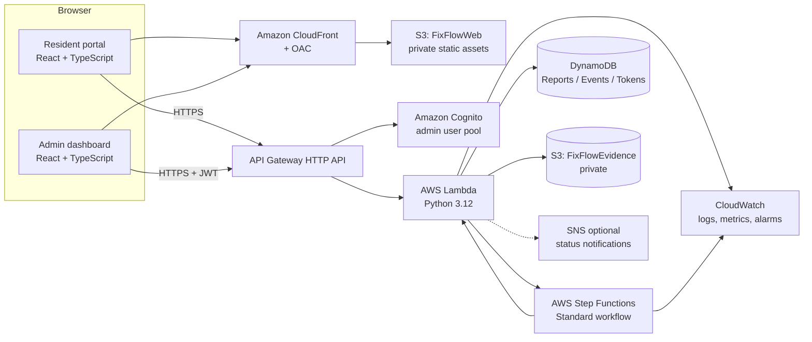
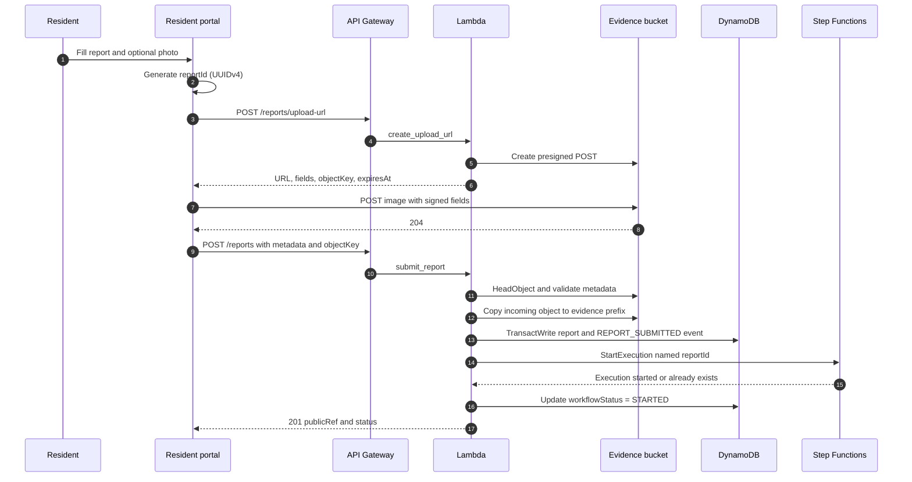
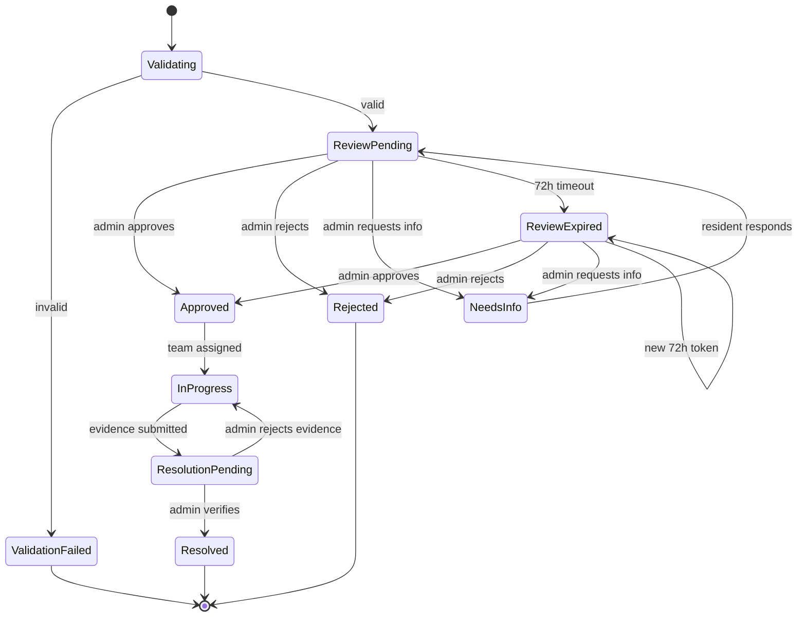

# FixFlow Architecture

**Status:** design baseline for the weekend build. No application code is deployed at this
commit. The source of truth for infrastructure will be `infrastructure/template.yaml`;
this document explains the decisions behind it.

Related documents:

- [API contract](api.md)
- [Data model](data-model.md)
- [Security and privacy](security.md)
- [README](../README.md)

---

## 1. Goals and constraints

FixFlow must demonstrate one complete, reliable workflow:

```text
resident submits report
  -> system validates
  -> system suggests priority
  -> administrator reviews
  -> administrator assigns
  -> team submits resolution evidence
  -> administrator verifies
  -> report is resolved
```

Constraints that shape the design:

- **Weekend build.** Prefer managed services and a small number of moving parts.
- **No servers and no deployment pipeline.** Everything is deployed with AWS SAM from a workstation.
- **Human decisions are authoritative.** Priority is a suggestion; resolution requires administrator verification.
- **Every transition is auditable.** A status change without an event is a bug.
- **The public surface must not leak resident data.** Public tracking uses a separate reference and a filtered projection.
- **The demo must survive a live walkthrough.** Failure paths, retries, and timeouts need defined behavior, not optimistic assumptions.

## 2. Design principles

1. **One writer per resource.** `submit_report` is the only function that creates a report. A status transition is the only way to change lifecycle state.
2. **Explicit state machine.** Allowed transitions are enumerated in code and documented. No handler sets status from an arbitrary client value.
3. **Transaction or it did not happen.** A status update and its audit event are written in one DynamoDB transaction.
4. **The browser is untrusted.** It never receives task tokens, raw bucket credentials, internal evidence keys, or another resident's data.
5. **Evidence is private by default.** Uploads use short-lived presigned POSTs; reads use short-lived presigned GETs for admins only.
6. **Idempotency is structural.** The report ID is client-generated and used as the idempotency key; repeated decisions fail on `version` and status conditions.
7. **No PII in orchestration payloads.** Step Functions executions carry `reportId` and `publicRef`, not the report description or contact details.
8. **Demo data is labeled.** Seeded records carry `dataSource = DEMO`; metrics exclude them unless demo mode is explicitly enabled.

## 3. System context



Trust boundaries:

- **Public boundary:** resident browser to CloudFront and API Gateway.
- **Admin boundary:** Cognito-authenticated dashboard to admin API routes.
- **Service boundary:** Lambda to DynamoDB, S3, and Step Functions, restricted by least-privilege IAM roles.
- **Human boundary:** Step Functions waits for an administrator or resident callback; the task token is the capability to resume, so it never leaves the backend.

## 4. Component responsibilities

| Component | Responsibility | Why it is here |
| --- | --- | --- |
| React + TypeScript + Vite | Resident portal and admin dashboard. | Fast static build, no server rendering, simple CloudFront delivery. |
| CloudFront + S3 `FixFlowWeb` | Static hosting and global delivery. | Private bucket with OAC; no public S3 website endpoint. |
| API Gateway HTTP API | Public and admin HTTP entry point. | Lower cost and latency than REST API; native JWT authorizer for Cognito. |
| Lambda | Validation, persistence, presigned URLs, transitions, callbacks, metrics. | Small handlers with per-function IAM roles. |
| Step Functions Standard | Durable orchestration with `.waitForTaskToken` human steps. | Express workflows cannot wait for a callback token; Standard supports long waits. |
| DynamoDB `FixFlowReports` | Report records and query indexes. | On-demand capacity, single-digit-millisecond reads, conditional writes. |
| DynamoDB `FixFlowReportEvents` | Append-only audit history. | Query by report, ordered by event ID. |
| DynamoDB `FixFlowWorkflowTokens` | Short-lived Step Functions task tokens. | Keeps tokens out of report records and public responses; TTL cleanup. |
| S3 `FixFlowEvidence` | Private report and resolution evidence. | Presigned POST uploads, presigned GET reads, no public access. |
| Cognito | Admin identity and `admin` group. | Managed login, JWT issuance, no custom password handling. |
| CloudWatch | Structured logs, metrics, alarms, dashboard. | Native integration with API Gateway, Lambda, Step Functions, and DynamoDB. |
| SNS (optional) | Status notifications after the core workflow is stable. | Decoupled, not required for the demo. |

### Lambda responsibilities

| Function | Trigger | Responsibility |
| --- | --- | --- |
| `create_upload_url` | `POST /reports/upload-url` | Validate content type and size; return a presigned POST bound to `reportId` and `uploadId`. |
| `submit_report` | `POST /reports` | Verify the uploaded object, copy it to the evidence prefix, create the report and first event transactionally, start the workflow. |
| `get_public_report` | `GET /public/reports/{publicRef}` | Resolve `publicRef`, return a filtered public projection. |
| `get_public_events` | `GET /public/reports/{publicRef}/events` | Return only events marked `visibility = PUBLIC`. |
| `respond_clarification` | `POST /public/reports/{publicRef}/clarification` | Accept a resident response, append an event, transition `NEEDS_INFO -> REVIEW_PENDING`, and start a new review execution. |
| `get_reports` | `GET /admin/reports` | Paginated list by status, filtered by category, newest first. |
| `get_report` | `GET /admin/reports/{reportId}` | Full report, event history, and short-lived evidence URLs. |
| `review_report` | `POST /admin/reports/{reportId}/decision` | Validate admin role and transition; resume the review callback. |
| `assign_report` | `POST /admin/reports/{reportId}/assign` | Validate admin role and team label; resume the assignment callback. |
| `create_resolution_upload_url` | `POST /admin/reports/{reportId}/resolution/upload-url` | Presign a resolution evidence upload. |
| `submit_resolution` | `POST /admin/reports/{reportId}/resolution` | Verify evidence, transition to `RESOLUTION_PENDING`, resume the resolution callback. |
| `verify_resolution` | `POST /admin/reports/{reportId}/verify` | Validate admin decision and resume the verification callback. |
| `get_metrics` | `GET /admin/metrics` | Operational counts and averages, excluding demo data by default. |
| `validate_report` | Step Functions task | Check required fields, category, coordinates, and evidence metadata. |
| `calculate_priority` | Step Functions task | Apply the published deterministic scoring rules. |
| `transition_report` | Step Functions task | Perform a conditional status update plus event insert in one transaction. |
| `store_task_token` | Step Functions `.waitForTaskToken` task | Store the task token with TTL and return; the task remains open until a callback. |
| `record_workflow_failure` | Step Functions catch | Write an admin-visible `WORKFLOW_FAILED` event and set `workflowStatus = FAILED`; the lifecycle status is left unchanged for reconciliation. |

`get_public_events` can be merged into `get_public_report` if the timeline is small. Keep
them separate if the public page needs independent pagination or caching.

## 5. Request flows

### 5.1 Report submission



Key points:

- The browser generates `reportId` once and reuses it on retry. It is both the primary key
  and the idempotency key. The server rejects a second create with a different request hash.
- `POST /reports/upload-url` does not create a database record. There are no orphan drafts.
- The presigned POST is bound to the exact object key, content type, and a maximum size.
  The object carries `x-amz-meta-report-id` and `x-amz-meta-upload-id`.
- `submit_report` verifies the object metadata before copying it. A client cannot claim an
  object that belongs to another report.
- The report and its first audit event are written in one transaction. The workflow starts
  with an execution name equal to `reportId`, making a retry safe.
- Step Functions receives `{ "reportId": "...", "publicRef": "..." }` only.

### 5.2 Human review callback

```mermaid
sequenceDiagram
  autonumber
  participant SF as Step Functions
  participant L as store_task_token
  participant DB as Tokens table
  participant A as Administrator
  participant API as API Gateway
  participant R as review_report

  SF->>L: Invoke with task token
  L->>DB: Put token, taskType = REVIEW, TTL
  L-->>SF: Return; task remains open
  A->>API: POST /admin/reports/{id}/decision
  API->>R: Validate JWT and admin group
  R->>DB: Load REVIEW token
  R->>DB: Conditional update PENDING -> CONSUMED
  R->>DB: TransactWrite status and event
  R->>SF: SendTaskSuccess
  SF-->>R: Execution resumes
  R-->>A: 200 with new status
```

The same pattern is used for assignment, resolution, and verification with different
`taskType` values. The task token is a bearer capability: anyone who has it can resume the
workflow. It is stored server-side, never returned by an API, never logged, and expires with
the task.

If `SendTaskSuccess` fails with `TaskTimedOut` or `InvalidToken`, the token is already
invalid. The handler must not retry forever. If the status transition already committed, it
may retry with the latest `PENDING` token for the same task type; otherwise it records the
expiry and returns a conflict.

### 5.3 Resolution and verification

1. An administrator assigns an approved report to a team. The assignment callback resumes
   the workflow and the report becomes `IN_PROGRESS`.
2. The administrator requests a resolution upload URL. The presigned POST is bound to the
   same `reportId` and a new `uploadId`.
3. `submit_resolution` verifies the object, copies it to the resolution prefix, transitions
   the report to `RESOLUTION_PENDING`, and resumes the resolution callback.
4. `verify_resolution` accepts `VERIFIED` or `REJECTED`. `VERIFIED` moves the report to
   `RESOLVED`. `REJECTED` returns it to `IN_PROGRESS` and stores the verifier's note.
5. Every step writes an audit event in the same transaction as the status change.

### 5.4 Public tracking

1. The resident uses the high-entropy `publicRef` returned at submission.
2. `GET /public/reports/{publicRef}` resolves the reference through a GSI and returns
   category, area, status, priority, submission date, resolution date, and a public summary.
3. `GET /public/reports/{publicRef}/events` returns only events with `visibility = PUBLIC`.
4. The response never includes `reportId`, description, contact details, exact coordinates,
   evidence keys, presigned URLs, internal comments, or administrator identities.

Public lookup is capability-based: possession of the high-entropy reference grants read
access to the filtered projection. It is rate-limited and does not reveal whether a guessed
reference exists beyond a generic `404`.

## 6. Step Functions workflow



The `NEEDS_INFO -> REVIEW_PENDING` edge is a **new execution** started by the public
clarification endpoint, not a callback in the original execution. The `REVIEW_EXPIRED`
self-loop represents a fresh 72-hour review token; the report stays actionable by an
administrator throughout.

### State machine shape

The state machine is a Standard workflow defined in
`backend/statemachines/report_workflow.asl.json`.

| State | Type | Behavior |
| --- | --- | --- |
| `ResumeChoice` | Choice | If `$.resumeFrom == "REVIEW"`, go directly to `StoreReviewToken`; otherwise go to `MarkValidating`. |
| `MarkValidating` | Task | `transition_report`: `SUBMITTED -> VALIDATING`. |
| `ValidateReport` | Task | Checks required fields, category, coordinates, and evidence metadata. Throws a business error on failure. |
| `MarkValidationFailed` | Task | `VALIDATING -> VALIDATION_FAILED`, with a reason code. |
| `CalculatePriority` | Task | Applies the published score; stores `priorityScore` and `priority`. |
| `MarkReviewPending` | Task | `VALIDATING -> REVIEW_PENDING`. |
| `StoreReviewToken` | Task, `.waitForTaskToken` | Stores the token as `REVIEW`; task stays open. `TimeoutSeconds = 259200` (72 hours). Catch `States.Timeout` to `MarkReviewExpired`. |
| `ReviewDecision` | Choice | Branches on `APPROVE`, `REJECT`, `REQUEST_INFO`. The source status may be `REVIEW_PENDING` or `REVIEW_EXPIRED`. |
| `MarkApproved` | Task | `REVIEW_PENDING -> APPROVED`. |
| `StoreAssignmentToken` | Task, `.waitForTaskToken` | Stores `ASSIGNMENT`; waits for a team. |
| `MarkInProgress` | Task | `APPROVED -> IN_PROGRESS`. |
| `StoreResolutionToken` | Task, `.waitForTaskToken` | Stores `RESOLUTION`; waits for evidence. |
| `MarkResolutionPending` | Task | `IN_PROGRESS -> RESOLUTION_PENDING`. |
| `StoreVerificationToken` | Task, `.waitForTaskToken` | Stores `VERIFICATION`; waits for an admin decision. |
| `VerificationDecision` | Choice | `VERIFIED -> MarkResolved`; `REJECTED -> MarkInProgress` and loop back to resolution. |
| `MarkResolved` | Task | `RESOLUTION_PENDING -> RESOLVED`. |
| `MarkRejected` | Task | `REVIEW_PENDING -> REJECTED`. |
| `MarkNeedsInfo` | Task | `REVIEW_PENDING -> NEEDS_INFO`, with `requiredActor = RESIDENT`. The execution ends; a resident response starts a new review execution. |
| `MarkReviewExpired` | Task | `REVIEW_PENDING -> REVIEW_EXPIRED` (no-op if already `REVIEW_EXPIRED`). The workflow then loops back to `StoreReviewToken` for a fresh 72-hour window, so an admin decision is still accepted while the report is `REVIEW_EXPIRED`. |
| `RecordWorkflowFailure` | Task, catch-all | Writes a `WORKFLOW_FAILED` event and sets `workflowStatus = FAILED`; the lifecycle status is not changed. |

### Callback rules

- Use `lambda:invoke.waitForTaskToken` for every human step.
- `store_task_token` receives the token, writes `{ reportId, taskType, taskToken, expiresAt, status: "PENDING" }`, and returns.
  Returning does **not** complete the task. The task completes only when a callback calls
  `SendTaskSuccess` or `SendTaskFailure`.
- Callback handlers load the token by `(reportId, taskType)`, conditionally mark it
  `CONSUMED`, and call `SendTaskSuccess`.
- Use `SendTaskFailure` only for genuine workflow failures, not for a normal rejection.
  A rejected report is a successful business outcome, not a failed execution.
- Never put the task token in an API response, a URL, a log line, or a Step Functions
  execution input that includes user data.
- Set `TimeoutSeconds` on every waiting task and define the catch path. The review wait is
  72 hours; later waits are 14 days. The demo exercises the happy path and the review
  timeout path only.

### Execution input

```json
{
  "reportId": "e3b0c442-98fc-4c14-9afb-f4c8996fb924",
  "publicRef": "FF-7K3M-9Q2X-4T8N-6V2B"
}
```

A resident clarification response starts a new execution with
`"resumeFrom": "REVIEW"`. The execution name is
`<reportId>-review-<eventId>`, which is deterministic and makes a retry safe. The original
execution ended at `NEEDS_INFO`; the new execution resumes at the review wait.

Do not put the description, contact details, evidence keys, or administrator notes in the
execution input. Step Functions execution history is retained and visible to operators.

## 7. Failure handling and idempotency

| Failure | Behavior |
| --- | --- |
| Duplicate `POST /reports` | Conditional put on `reportId`. If it exists with the same request hash, return the existing result. If the hash differs, return `409 CONFLICT`. |
| Duplicate decision or assignment | Conditional update on `status` and `version`. A stale `expectedVersion` returns `409 CONFLICT`. |
| Workflow start fails after the report is written | `workflowStatus = PENDING` remains. Retry uses the same execution name; `ExecutionAlreadyExists` is treated as success. An alarm fires if a report stays `PENDING` for more than 5 minutes. |
| Clarification response start fails | The report is already `REVIEW_PENDING`. Retry with the same `<reportId>-review-<eventId>` execution name; `ExecutionAlreadyExists` is treated as success. An alarm fires if `workflowStatus` stays `PENDING`. |
| Lambda transient failure | Step Functions retries with exponential backoff and jitter. Transition handlers are idempotent: if the report is already in the target state, they return success without writing a duplicate event. |
| Validation failure | Business error, not a retry. `VALIDATION_FAILED` with a reason code and an admin-visible event. |
| Evidence object missing | `422 EVIDENCE_NOT_FOUND`; the report is not created. |
| Presigned upload expires | `403` from S3; the client requests a new URL. |
| Review timeout | `REVIEW_EXPIRED`; the workflow issues a fresh 72-hour token, and an admin decision is still accepted. |
| Unhandled workflow error | Catch-all writes `WORKFLOW_FAILED`, sets `workflowStatus = FAILED`, leaves the lifecycle status unchanged, and fires an alarm. An operator reconciles from the logs. |
| API throttling | `429 RATE_LIMITED`; the client backs off. |

Idempotency decisions:

- **Report creation:** the client generates `reportId` and reuses it on retry. This avoids a
  fourth DynamoDB table for idempotency keys.
- **Status transitions:** `version` is incremented on every write. Admin requests include
  `expectedVersion`; the server rejects stale writes.
- **Workflow callbacks:** the token record is conditionally consumed before
  `SendTaskSuccess`. A repeated callback gets a conflict, not a second transition.

## 8. Observability

### Logs

Every Lambda emits one structured JSON line per request:

```json
{
  "level": "INFO",
  "service": "fixflow",
  "function": "submit_report",
  "requestId": "01J...",
  "route": "POST /reports",
  "reportId": "e3b0c442-...",
  "status": 201,
  "latencyMs": 84,
  "errorCode": null
}
```

Never log: names, email addresses, phone numbers, descriptions, coordinates, task tokens,
presigned URLs, Authorization headers, or raw S3 keys.

### Metrics and alarms

Custom metrics:

- `ReportsSubmitted`
- `ReportsResolved`
- `ReviewExpired`
- `UploadValidationFailures`
- `WorkflowFailures`
- `StuckPendingWorkflows`

Alarms:

- Any Step Functions failed execution in 5 minutes.
- API Gateway 5XX rate above 1% for 5 minutes.
- Lambda errors above 0 for 5 minutes.
- `StuckPendingWorkflows` above 0.
- AWS Budget forecast above the configured threshold.

### Tracing

Enable AWS X-Ray on API Gateway, Lambda, and Step Functions. Use `ERROR` logging for Step
Functions, not `ALL`, to avoid retaining large or sensitive execution payloads. Lambda logs
carry the correlation ID.

## 9. Deployment topology

One SAM stack, `fixflow`, contains:

- S3 bucket `FixFlowWeb` (private, CloudFront OAC only).
- S3 bucket `FixFlowEvidence` (private, block public access, SSE, versioning, TLS-only policy).
- DynamoDB tables `FixFlowReports`, `FixFlowReportEvents`, `FixFlowWorkflowTokens`.
- Cognito user pool, app client, hosted UI domain, and `admin` group.
- HTTP API with public and admin routes, CORS, stage throttling, and a JWT authorizer.
- Lambda functions and per-function IAM roles.
- Step Functions state machine and its role.
- CloudWatch log groups, alarms, and dashboard.
- Optional SNS topic for status notifications.

Deployment order:

1. `sam build`
2. `sam deploy --guided --stack-name fixflow`
3. Build the frontend with the API and Cognito outputs.
4. `aws s3 sync frontend/dist s3://<FixFlowWebBucket> --delete`
5. Create a CloudFront invalidation for `/*`.

There is no CI/CD pipeline. The challenge explicitly favors no pipeline to manage, and a
local deploy keeps the feedback loop short. Do not add GitHub Actions for this submission.

CloudFront uses OAC to read the private web bucket. The SPA fallback maps `403` and `404`
to `/index.html`. Hashed assets are cached for one year; `index.html` is `no-cache`.

## 10. Cost

The demo should stay well under the AWS Free Tier for most services. Approximate
monthly cost at demo volume:

| Service | Assumption | Approximate cost |
| --- | --- | --- |
| Lambda | < 100k requests, 128-512 MB, short duration | Free tier |
| API Gateway HTTP API | < 1M requests | ~$1.00 per million after free tier |
| DynamoDB on-demand | < 1M writes, < 1M reads | A few cents |
| S3 | < 1 GB evidence and assets | Cents |
| Step Functions Standard | < 10k transitions | ~$0.25 |
| Cognito | < 50k MAU | Free tier |
| CloudFront | < 1 TB transfer | Free tier / cents |
| CloudWatch | Logs, metrics, alarms | Cents to a few dollars |
| WAF (optional) | Web ACL + rules | ~$5+ per month |

Set an AWS Budget alert at a low threshold (for example, $10) and a second at $25. Run the
cleanup procedure after the judging period: `sam delete`, after emptying both S3 buckets.
S3 buckets with objects can block stack deletion.

## 11. Security summary

The full threat model and controls are in [security.md](security.md). The non-negotiables:

- Admin routes require a valid Cognito JWT **and** membership in the `admin` group.
- Public routes return only a filtered projection and are rate-limited.
- Evidence buckets block all public access, enforce TLS, and use short-lived presigned URLs.
- Task tokens are server-side only, TTL-bound, and never logged.
- Status changes and audit events are transactional.
- IAM roles are per function and least privilege.
- No secrets in the repository, frontend bundle, or logs.

## 12. Corrections to the source blueprint

The PDF is the product source. This table records where the implementation deliberately
diverges, and why. Each correction is reflected in the API, data model, or security docs.

| # | Source blueprint | Problem | Decision |
| --- | --- | --- | --- |
| 1 | Architecture diagram on page 5 | The PDF contains only arrows and no readable components. | Replaced with Mermaid context, sequence, and state diagrams in this document. |
| 2 | Lambda list on page 7 vs repository tree on page 11 | `submit_report`, `get_reports`, and `submit_resolution` appear in one list but not the other. | One canonical inventory, used by the SAM template and the repository layout. |
| 3 | `create_report` "create draft and generate upload URL" | There is no draft endpoint, and `submit_report` also persists the report. Two writers would create orphan records. | `create_upload_url` only signs; `submit_report` is the single writer. No drafts. |
| 4 | "Add a GSI... choose the exact keys" | The most important query design was deferred. | Define `GSI1` for status, `GSI2` for public reference, and `GSI3` for the all-reports list. See [data model](data-model.md#indexes-and-access-patterns). |
| 5 | `GET /reports/{reportId}` for public tracking | Exposes the internal identifier and encourages enumeration. | Public tracking uses `GET /public/reports/{publicRef}` with a separate 80-bit reference. |
| 6 | `POST /reports/{reportId}/resolution/*` | Ambiguous whether residents/teams can call it. The MVP has no team login. | Admin-only resolution endpoints; admins act on behalf of teams in the MVP. |
| 7 | `NEEDS_INFO` with no response endpoint | A resident cannot answer a clarification request. | Add `POST /public/reports/{publicRef}/clarification`. |
| 8 | Status list on page 4 | No state for validation failure or review timeout. | Add `VALIDATION_FAILED` and `REVIEW_EXPIRED`; `NEEDS_INFO` records `requiredActor`. |
| 9 | "Store the token server-side" | Unspecified storage, access, and retention. | Dedicated `FixFlowWorkflowTokens` table with TTL, conditional consumption, and no public read path. |
| 10 | Audit history described but not enforced | A status write could succeed while its event fails. | `TransactWriteItems` for the report update and event insert. |
| 11 | Client-supplied S3 key | A client could claim another upload or a key it does not own. | Presigned POST binds the exact key, content type, size, `reportId`, and `uploadId`; submit verifies object metadata. |
| 12 | "Keep the frontend bucket separate" | Correct, but the delivery mechanism is unspecified. | Separate `FixFlowWeb` and `FixFlowEvidence`; CloudFront OAC for the web bucket; no public S3 access. |
| 13 | "Use idempotency keys or conditional writes" | No mechanism chosen. | Client-generated `reportId` plus conditional puts; `version` plus `expectedVersion` for transitions. |
| 14 | Priority rules not published | "Transparent" is a claim without the rule table. | Publish severity and category weights, score bands, and worked examples in [data model](data-model.md#8-priority-rules). |
| 15 | Metrics can include seeded data | Simulated outcomes could be presented as real. | `dataSource = DEMO` on seeded records; metrics exclude demo data by default; dashboard shows a demo badge. |
| 16 | Step Functions input unspecified | Execution history could retain PII. | Execution input carries only `reportId` and `publicRef`. |
| 17 | "Monday, November 16 at 9:00 PM EAT" submission target | The time-zone conversion was easy to misread against the Pacific deadline. | State both: 9:00 PM EAT = 10:00 AM Pacific, three hours before the 1:00 PM Pacific deadline. |
| 18 | Optional AI extension | Risk of implying automated decisions. | AI stays out of the MVP. If added, it is advisory, has no write path, and never sets priority, approval, assignment, or verification. |

## 13. Demo storyboard

| Time | Scene | Show | Say |
| --- | --- | --- | --- |
| 0:00-0:25 | The problem | A short before/after: a report in a social feed vs a tracked FixFlow record. | "Reporting is not the hard part. Knowing whether anything happened is." |
| 0:25-0:55 | Submit a report | Fill the form, upload a photo, submit, show the public reference. | "The resident gets a reference and a private evidence upload. No file bytes pass through Lambda." |
| 0:55-1:35 | Serverless workflow | Open the Step Functions execution; show validation, priority, and the waiting review task. | "Priority is deterministic and published. The workflow is waiting for a human, not guessing." |
| 1:35-2:05 | Human approval | Approve in the dashboard, assign a team, show the status transition and audit event. | "The callback token stays server-side. The admin decision resumes the workflow." |
| 2:05-2:35 | Resolution | Upload completion evidence, verify it, show `RESOLVED`. | "A repair is not resolved until an administrator verifies the evidence." |
| 2:35-2:55 | Architecture and impact | Show the architecture diagram and the public tracking page. | "The same loop works for any community organization. The services scale to zero when idle." |

Keep the video under three minutes. Show the live application, not only slides. Do not show
credentials, tokens, presigned URLs, private resident data, or sensitive console details.

## 14. Architecture decision log

| ID | Decision | Rationale | Consequence |
| --- | --- | --- | --- |
| ADR-001 | Step Functions Standard with `.waitForTaskToken` | Durable human-in-the-loop waits; Express cannot wait for callbacks. | Standard transition pricing; long-running executions need timeouts. |
| ADR-002 | Admins act on behalf of maintenance teams in the MVP | Avoids a second identity system and a second authorization matrix this weekend. | The demo shows the lifecycle, not team self-service. A `team` Cognito group is a later extension. |
| ADR-003 | High-entropy `publicRef` for tracking | The internal `reportId` should not be a public capability; short references are enumerable. | One extra GSI and a reference generator. |
| ADR-004 | Deterministic priority, no AI in the MVP | Transparency and testability; human review remains authoritative. | A published rule table must be maintained. |
| ADR-005 | SAM deploy from a workstation, no pipeline | The challenge favors no pipeline to manage; fewer moving parts. | Manual deploy and a documented cleanup step. |
| ADR-006 | Separate web and evidence buckets | Different access patterns, lifecycle, and blast radius. | Two buckets and two sets of policies. |
| ADR-007 | Transactional status + event writes | Audit history cannot silently drift from state. | Slightly higher write cost; all transitions go through one helper. |
| ADR-008 | Client-generated `reportId` as idempotency key | Avoids a fourth table and makes retries deterministic. | The server must validate UUID format and reject conflicting request hashes. |
| ADR-009 | Admin-only resolution endpoints | No maintenance-team login in the MVP. | The assignment is a label; a future team role can call the same endpoints. |
| ADR-010 | Public projection excludes description and coordinates | The description can contain PII; exact coordinates can identify a location or person. | Public page shows category, area, status, priority, and a curated timeline. |

## 15. Open architecture questions

- **Region:** which AWS region hosts the demo? Choose one with Cognito, Step Functions, and CloudFront support; `us-east-1` is the simplest default.
- **Same-origin API:** should CloudFront proxy `/api/*` to API Gateway to eliminate CORS, or keep the API on its own origin for a simpler SAM template? The current design keeps separate origins with an exact CORS allowlist.
- **Contact data:** does the MVP collect an optional email for follow-up, or no contact data at all? The security doc assumes no contact data by default.
- **WAF:** is the extra monthly cost acceptable for per-IP rate limiting, or is API Gateway stage throttling sufficient for the demo?
- **Team identity:** should the next iteration add a Cognito `team` group, or keep the admin-as-team model?
- **Retention:** how long should evidence and audit events be retained after the challenge? The default recommendation is 30 days for evidence and 90 days for events, then delete the stack.
