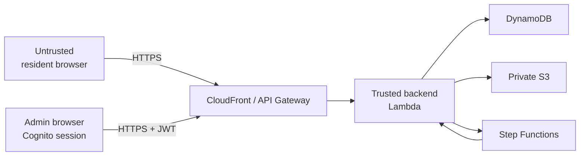

# FixFlow Security and Privacy

**Status:** design baseline for the weekend build. No application code is deployed at this
commit. This document describes the controls the implementation must satisfy; it is not a
claim that they are already in place.

Related documents:

- [Architecture](architecture.md)
- [API contract](api.md)
- [Data model](data-model.md)

---

## 1. Scope and posture

FixFlow is a public civic reporting tool. Even a weekend demo can receive real reports,
real photographs, and real location data. The security posture is therefore:

- **Collect less.** The MVP collects no resident name, email, phone number, or account.
- **Expose less.** Public tracking returns a curated projection, not the report record.
- **Trust the backend.** The browser never decides authorization, status, priority, or verification.
- **Keep capabilities server-side.** Task tokens, presigned URLs, and raw evidence keys never reach a public response.
- **Make abuse boring.** Rate limits, size limits, strict schemas, and generic errors.
- **Be honest about limits.** This is not a government system, has no formal authority integration, and has not been penetration-tested.

The MVP is not certified for sensitive personal data, law enforcement, emergency response,
or regulated civic records. Do not position it as an official government channel.

## 2. Assets and trust boundaries

### Assets

| Asset | Why it matters |
| --- | --- |
| Resident report descriptions | May contain names, addresses, or other personal details. |
| Report photographs and resolution evidence | May show people, plates, homes, or private property. |
| Exact coordinates | Can identify a location or a person. |
| Administrator identities and sessions | Compromise grants review, assignment, and verification powers. |
| Step Functions task tokens | Bearer capabilities that can resume a human approval step. |
| Audit events | Integrity matters; they are the accountability record. |
| AWS account and IAM roles | Compromise is a full-system compromise. |
| Presigned upload URLs | Temporary write access to a specific object. |
| Public tracking references | Capability to read a filtered report view. |

### Trust boundaries



- The browser is untrusted, including the admin browser. A valid JWT is necessary but the
  backend still checks the `admin` group and the report state.
- The backend is trusted only within its least-privilege role.
- S3 and DynamoDB are private; there is no direct public path.
- Step Functions is trusted to wait, but its task tokens are treated as secrets.

## 3. Threat model

| Threat | Example | Control |
| --- | --- | --- |
| Spoofing | A user calls an admin endpoint with a forged or stolen token. | Cognito JWT validation at API Gateway, `admin` group check in Lambda, short token lifetimes, MFA for admins. |
| Tampering | A client sends `status: "RESOLVED"` in a report payload. | Status is never accepted from the client; only explicit actions with server-side transition rules. |
| Repudiation | An admin denies approving a report. | Append-only events with `actorType`, `actorId`, timestamp, previous and new status, written in the same transaction as the state change. |
| Information disclosure | A public lookup returns the resident's description or exact coordinates. | Explicit public projection; no PII fields, no evidence keys, no internal IDs. |
| Information disclosure | A guessed reference enumerates reports. | 80-bit `publicRef`, generic `404`, rate limiting, no sequential IDs. |
| Denial of service | A script uploads thousands of files or spams report creation. | API throttling, per-IP WAF rule if enabled, 10 MiB limit, 5-minute upload URLs, lifecycle cleanup. |
| Elevation of privilege | A resident calls an admin route. | Route-level JWT authorizer plus backend group check; no client-side-only checks. |
| Token theft | A task token leaks in a log or API response. | Tokens stored in a dedicated table, never logged, never returned, TTL-bound, single-use. |
| Malicious upload | An HTML or SVG file is uploaded as an image. | Allow only JPEG, PNG, and WebP; validate magic bytes; `X-Content-Type-Options: nosniff`; no SVG. |
| Supply chain | A compromised npm package exfiltrates tokens. | Lockfile, `npm audit`, no third-party scripts, strict CSP, minimal dependencies. |
| Account compromise | Leaked AWS access keys in the repository. | No long-lived keys in the repo; SSO or local profiles; secret scanning before submission. |
| Cost abuse | A bot triggers many Step Functions transitions. | Throttling, budget alarms, cheap idempotent handlers, cleanup. |

## 4. Identity and access

### 4.1 Administrator authentication

- **Cognito user pool:** `fixflow-admins`.
- **Self-registration:** disabled. An operator creates admin users.
- **App client:** public SPA client, no client secret. The SPA cannot keep a secret.
- **Hosted UI:** recommended for the weekend to avoid writing a custom password flow.
- **Group:** `admin`. Membership is required for every admin route.
- **MFA:** TOTP is optional in Cognito but strongly recommended for the demo admin. If time is short, enable it manually on the demo account rather than building an MFA UI.
- **Password policy:** minimum 12 characters, upper and lower case, number, symbol. Cognito's defaults can be tightened.
- **Token lifetimes:** access token 1 hour, ID token 1 hour, refresh token 7 days. Shorter is better; the demo does not need 30-day sessions.
- **Callback URLs:** exact CloudFront URL and `http://localhost:5173/auth/callback` in development. No wildcards.
- **Logout URLs:** exact CloudFront URL and the local development URL.

### 4.2 API authorization

- API Gateway HTTP API uses a **JWT authorizer** for `/admin/*`.
- Issuer: `https://cognito-idp.<AWS_REGION>.amazonaws.com/<userPoolId>`.
- Audience: the admin app client ID.
- The authorizer validates signature, issuer, audience, and expiry. It does not enforce group membership.
- A shared Lambda helper `require_admin(event)` checks `cognito:groups` contains `admin` and returns `403 FORBIDDEN` otherwise.
- Public routes have no authorizer. They are capability-based or intentionally public.

**Rule:** every admin handler calls `require_admin` at the top, before parsing the body or
touching DynamoDB. Do not rely on the API Gateway route configuration alone.

### 4.3 Resident identity

The MVP has no resident accounts. A resident is identified only by the `publicRef` returned
at submission. That reference is a capability: anyone who has it can view the public
projection and, when the report is `NEEDS_INFO`, submit a clarification.

Accepted risk: a resident can share the reference. This is equivalent to sharing a tracking
number. The public projection contains no PII, so the impact is limited. If the product
later adds contact data or private messages, add a second factor or an account.

### 4.4 AWS IAM

- One role per Lambda function. No shared "fixflow-lambda" role with broad permissions.
- The web frontend has no AWS credentials. It talks only to API Gateway and Cognito.
- No long-lived access keys in the repository, `.env` files, or the frontend bundle.
- Local deployment uses an AWS CLI profile or IAM Identity Center. Do not use the root account.
- CloudFormation deploy role: review the `--guided` prompts. Do not grant `AdministratorAccess` to a runtime Lambda.
- Runtime roles get only the actions and resources they need. Examples:

| Function | Allowed | Explicitly not allowed |
| --- | --- | --- |
| `create_upload_url` | `s3:PutObject` on `incoming/*` | `s3:GetObject`, `s3:DeleteObject`, DynamoDB |
| `submit_report` | `s3:GetObject`, `s3:PutObject`, `s3:DeleteObject` on `incoming/*` and `evidence/*`; `dynamodb:PutItem`/`GetItem` on reports; `dynamodb:PutItem` on events; `states:StartExecution` | `dynamodb:Scan`, `dynamodb:DeleteTable`, `s3:*` on the web bucket |
| `get_public_report` | `dynamodb:Query` on `GSI2`; `dynamodb:GetItem` on reports | `dynamodb:Scan`, events table, S3 |
| `get_reports` | `dynamodb:Query` on `GSI1` and `GSI3` | `dynamodb:Scan`, writes |
| `get_report` | `dynamodb:GetItem` on reports; `dynamodb:Query` on events; `s3:GetObject` on evidence for presigning | Writes, public buckets |
| `review_report` / `assign_report` / `submit_resolution` / `verify_resolution` | Conditional updates on reports; `PutItem` on events; `GetItem`/`UpdateItem` on tokens; `states:SendTaskSuccess` | `states:StartExecution`, `states:StopExecution`, `dynamodb:DeleteItem` on events |
| `transition_report` | `dynamodb:UpdateItem` on reports; `dynamodb:PutItem` on events | `dynamodb:DeleteItem`, `dynamodb:UpdateItem` on events |
| `store_task_token` | `dynamodb:PutItem` on tokens | Reports, S3 |
| `calculate_priority` | `dynamodb:UpdateItem` on reports | S3, Step Functions control plane |
| `get_metrics` | `dynamodb:Query` on `GSI1` and `GSI3` | `dynamodb:Scan` |

Additional IAM guardrails:

- Explicitly deny `dynamodb:UpdateItem` and `dynamodb:DeleteItem` on the events table for
  every runtime role, even though those actions are not granted.
- Deny `dynamodb:Scan` on the reports table for runtime roles. The app uses queries.
- Deny `s3:PutBucketPolicy`, `s3:PutBucketAcl`, and `s3:DeleteBucket` for runtime roles.
- Scope `states:SendTaskSuccess` and `states:SendTaskFailure` to the callback functions.
  Do not grant workflow control actions to read-only or upload functions.
- Enable IAM Access Analyzer and review findings before submission.

## 5. Public surface controls

### 5.1 High-entropy public reference

- Format: `FF-XXXX-XXXX-XXXX-XXXX`, 16 Crockford Base32 characters after `FF`.
- Entropy: 80 bits. Guessing is impractical.
- Normalize input to uppercase and strip hyphens before lookup.
- Use the same generic `404` for "not found", "expired", and "invalid format". Do not reveal
  whether a reference exists.
- Rate-limit lookups. Do not add an autocomplete or search-by-description public endpoint.

### 5.2 Public projection

The public response is built from an explicit allowlist, not by deleting fields from the
stored item:

```text
publicRef, category, area, status, priority,
submittedAt, resolvedAt, publicSummary, lastUpdatedAt
```

Never include:

- `reportId`
- `description`
- `location.latitude`, `location.longitude`
- `evidenceKey`, `resolutionEvidenceKey`
- presigned URLs
- `assignedTeam`? The current contract includes it only if the team label is public-safe.
  The MVP does not return it. If it is added, use a public display name, not an internal team ID.
- administrator names, Cognito `sub`, email addresses
- `comment`, `reviewedAt`, `approvedAt` (timestamps can imply staffing patterns; the public
  page only needs submission and resolution dates)
- task tokens, execution ARNs, workflow status

### 5.3 Rate limiting and abuse

- API Gateway stage throttle: 20 requests/second, burst 40.
- Per-IP WAF rate-based rule is recommended if the budget allows it. Suggested limits:
  - `POST /reports` and `POST /reports/upload-url`: 10 requests per 5 minutes per IP.
  - Public tracking: 60 requests per 5 minutes per IP.
  - Clarification: 10 requests per 5 minutes per IP.
- Return `429` with `Retry-After`.
- Enforce the 10 MiB evidence limit at the presigned POST, not only in application code.
- Use a 5-minute presigned URL lifetime. Do not issue 1-hour upload URLs "for convenience."
- Add a basic duplicate safeguard: the same `reportId` cannot create two reports, and the
  same `(category, area, description hash)` within 10 minutes can be flagged for review.
  Do not block legitimate repeat reports silently.

### 5.4 CORS and headers

- `Access-Control-Allow-Origin`: exact CloudFront origin or localhost in development. No `*`.
- `Access-Control-Allow-Headers`: `Authorization`, `Content-Type`.
- `Access-Control-Allow-Methods`: `GET`, `POST`, `OPTIONS`.
- `Access-Control-Allow-Credentials`: false.
- CloudFront response headers:
  - `Strict-Transport-Security: max-age=31536000; includeSubDomains`
  - `X-Content-Type-Options: nosniff`
  - `Referrer-Policy: strict-origin-when-cross-origin`
  - `Permissions-Policy: geolocation=(self), camera=(), microphone=()`
  - `Content-Security-Policy` with `default-src 'self'`, `object-src 'none'`,
    `frame-ancestors 'none'`, `base-uri 'self'`, and explicit `connect-src` / `img-src`
    entries for the API, Cognito, and evidence bucket.

## 6. Evidence upload and storage

### 6.1 Presigned POST, not a public bucket

The browser uploads directly to S3 so image bytes never pass through Lambda. The presigned
POST is generated by `create_upload_url` and includes:

- Exact object key: `incoming/<reportId>/<uploadId>.<ext>`.
- `Content-Type` equal to the declared allowlisted type.
- `content-length-range` from 1 byte to 10 MiB.
- `x-amz-meta-report-id` equal to the report ID.
- `x-amz-meta-upload-id` equal to the upload ID.
- A 5-minute expiry.

The browser can only write to the exact key. It cannot list the bucket, read another object,
or choose a different prefix.

### 6.2 Server-side verification

`submit_report` and `submit_resolution` must verify:

1. The key matches the expected prefix and the report ID.
2. `HeadObject` returns the expected content type, size, and metadata.
3. The `uploadId` in the request matches the object metadata.
4. The file signature (magic bytes) matches JPEG, PNG, or WebP.
5. The object has not already been claimed by another report.

Only then copy the object from `incoming/` to `evidence/` or `resolution/`, and delete the
incoming object. A client-supplied key is never trusted on its own.

### 6.3 Bucket controls

- Block all public access at the account and bucket level.
- Object Ownership: BucketOwnerEnforced; ACLs disabled.
- Default encryption: SSE-S3 (`AES256`). SSE-KMS is a later hardening step.
- Bucket policy denies requests where `aws:SecureTransport` is false.
- Versioning enabled.
- `incoming/` lifecycle expires objects after 1 day.
- Noncurrent evidence versions expire after 30 days.
- CORS allows only the app origin.
- No static website hosting.
- No public object URLs. Admin evidence reads use a 5-minute presigned GET.

### 6.4 Malware and content safety

- Allow only raster images: JPEG, PNG, WebP. **Do not allow SVG**; SVG is an active content
  format and can contain scripts.
- Serve evidence with `Content-Type` from the validated metadata and
  `X-Content-Type-Options: nosniff`.
- The MVP does not include malware scanning. This is an accepted risk for a demo with
  invited testers. Before accepting public uploads at scale, enable S3 Malware Protection
  for S3 or a scanning pipeline, and quarantine objects until clean.
- Never execute or parse uploaded files as code. Do not generate thumbnails with an
  unpatched image library.

## 7. Workflow tokens

Step Functions task tokens are bearer capabilities. Anyone with a token can resume the
waiting task, so they are treated like passwords.

- Stored in `FixFlowWorkflowTokens`, not in the report item.
- TTL = task timeout + 1 day.
- Never returned by any API.
- Never written to logs, metrics, X-Ray annotations, or error messages.
- Consumed with a conditional update (`status = PENDING` and `taskVersion = current`).
- A repeated callback gets `409 CONFLICT`, not a second transition.
- Step Functions execution input contains only `reportId` and `publicRef`. Do not put the
  description, contact data, or evidence keys in the execution history.
- Step Functions logging is `ERROR`, not `ALL`. Execution history is retained by AWS; keep
  payloads minimal.
- A review timeout creates a fresh token; the old token is invalid. Do not extend a token
  indefinitely.

If a token is suspected leaked:

1. Stop the execution or let the task time out.
2. Mark the token `EXPIRED` in the tokens table.
3. Inspect CloudWatch and CloudTrail for unexpected `SendTaskSuccess` calls.
4. Record an incident note and re-drive the report through the admin flow.

## 8. Data protection and privacy

### 8.1 Data minimization

- No resident name, email, phone, or account in the MVP.
- `description` is required for the report, but it is admin-only. The public page shows
  category, area, status, priority, and a curated timeline.
- Coordinates are optional and admin-only. The public page uses `area`.
- Evidence is admin-only.
- Do not add analytics, session recording, or third-party trackers. They would create a new
  data flow and a new consent problem.

### 8.2 Logging

Allowed fields:

```text
level, service, function, requestId, route, reportId, status,
latencyMs, errorCode, workflowStatus
```

Forbidden fields:

```text
name, email, phone, description, latitude, longitude,
taskToken, Authorization, presigned URL, policy, signature,
evidenceKey, resolutionEvidenceKey, raw request body
```

Use a shared logger with a redaction list. Do not log the raw event object; API Gateway
events can contain headers and bodies.

### 8.3 Retention

- For the challenge, delete the stack after judging. Empty both S3 buckets first.
- Export audit events if they are needed for the submission write-up.
- A production policy should define retention per data class. A reasonable starting point
  is 30 days for evidence and 90 days for events, subject to the operating organization's
  policy and local law.
- DynamoDB PITR retains backups independently of item deletion. Disable or delete the
  stack when the demo is over.

### 8.4 Resident rights

The MVP has no resident account, so there is no self-service access or deletion flow. If a
resident asks for deletion, an operator must locate the report by public reference and
delete the report, its events, and its evidence. Document this as an operational procedure,
not a product feature. Before a real deployment, add a privacy notice and a deletion
process.

## 9. Application security

### 9.1 Input validation

- Validate every request against a strict schema. Reject unknown fields.
- Enforce enums for category, severity, status, decision, and task type.
- Enforce length limits on description, comment, public message, area, and team label.
- Validate UUIDs, ULIDs, and coordinates with strict parsers, not regular expressions alone.
- Reject control characters and null bytes.
- Use DynamoDB `ExpressionAttributeNames` and `ExpressionAttributeValues`. Never build
  expressions with string concatenation.
- Validate S3 keys with an allowlist regex and the expected prefix. Reject `..`, encoded
  separators, and keys that do not match the report ID.

### 9.2 Output safety

- React escapes text by default. Do not use `dangerouslySetInnerHTML`.
- Do not render Markdown or HTML from resident or admin input in the MVP.
- `publicMessage` is plain text, length-limited, and rendered as text.
- Error messages are stable, user-safe strings. Do not return stack traces, ARNs, bucket
  names, or DynamoDB exception text.

### 9.3 Browser session security

- Prefer an in-memory access token and a short-lived refresh token. If the chosen Cognito
  library persists tokens, use `sessionStorage` rather than `localStorage` where possible.
- If tokens must be persisted, document the XSS risk and keep the CSP strict.
- No third-party scripts, tag managers, or chat widgets in the admin dashboard.
- `npm audit` and a lockfile are required. Pin dependency versions.
- The admin dashboard should log out on token expiry and never cache report data in the
  service worker.

### 9.4 Dependency and supply chain

- Commit `package-lock.json` and a Python lock file (or a pinned `requirements.txt`).
- Run `npm audit` and `pip-audit` before submission.
- Do not add a dependency for a feature that can be implemented in a few lines.
- Do not load scripts from a CDN. CloudFront serves the app's own assets.

## 10. Infrastructure and account guardrails

- Enable MFA on the AWS account root user and do not create root access keys.
- Use IAM Identity Center or a named admin role with MFA for deployment.
- Enable CloudTrail in the region. Management events are enough for the weekend.
- Enable AWS Budgets with alerts at $10 and $25. Optionally add a CloudWatch billing alarm.
- Enable S3 Block Public Access at the account level.
- Enable IAM Access Analyzer.
- Enable DynamoDB PITR on reports and events.
- Enable CloudFront OAC; do not use a public S3 website endpoint.
- Do not disable CloudTrail, GuardDuty, or budget alarms to "make the demo faster."
- Review the SAM template for wildcard IAM policies before deploying. A wildcard
  `Action: "*"` or `Resource: "*"` is a bug.
- After the challenge, run `sam delete`, empty both buckets, and remove the Cognito user
  pool if it is not part of a retained demo.

## 11. Monitoring and incident response

### Alarms

- Any Step Functions failed execution.
- API Gateway 5XX rate above 1% for 5 minutes.
- Lambda errors above 0 for 5 minutes.
- `StuckPendingWorkflows` above 0.
- `ReviewExpired` above the expected threshold.
- AWS Budget forecast above the configured threshold.

### Incident checklist

1. **Contain:** disable the affected Cognito user, revoke refresh tokens, or block the
   offending IP with WAF.
2. **Preserve evidence:** export relevant CloudWatch logs and CloudTrail events. Do not
   delete the report or its events yet.
3. **Assess:** determine whether a task token, admin session, or evidence object was
   exposed. Check `SendTaskSuccess` calls and S3 access logs if enabled.
4. **Eradicate:** rotate anything that can be rotated. There are no application secrets in
   the MVP, but Cognito sessions and IAM credentials may need revocation.
5. **Recover:** re-drive affected reports through the admin flow. Verify status and audit
   history.
6. **Learn:** write a short incident note with timeline, impact, and follow-up. Do not
   include PII in the note.

## 12. Pre-demo security checklist

- [ ] Cognito self-registration is disabled.
- [ ] The demo admin has MFA enabled.
- [ ] `GET /admin/reports` returns `401` without a token.
- [ ] The same route returns `403` for a valid non-admin token.
- [ ] Public lookup returns no `reportId`, description, coordinates, evidence key, or contact data.
- [ ] Public lookup returns a generic `404` for an unknown reference.
- [ ] An S3 object URL without a signature returns `403`.
- [ ] A presigned upload rejects the wrong content type and a file over 10 MiB.
- [ ] A presigned upload cannot write outside `incoming/<reportId>/`.
- [ ] A presigned GET expires after 5 minutes.
- [ ] Task tokens do not appear in API responses or CloudWatch logs.
- [ ] `Cache-Control: no-store` is set on admin report responses.
- [ ] CSP, HSTS, `nosniff`, and `Referrer-Policy` are present in the deployed app.
- [ ] CORS allows only the CloudFront origin and localhost in development.
- [ ] `npm audit` and `pip-audit` are clean or the remaining findings are documented.
- [ ] No AWS keys, Cognito secrets, or `.env` files are committed.
- [ ] AWS Budget alerts are active.
- [ ] CloudTrail is on.
- [ ] Demo data is labeled `dataSource = DEMO`.
- [ ] The cleanup procedure is written down and tested.

## 13. Accepted risks and out of scope

| Risk | Why accepted for the MVP | Follow-up |
| --- | --- | --- |
| Public reference can be shared | It is a tracking capability, and the public view has no PII. | Add resident accounts or a second factor if private messaging is added. |
| No resident contact or notification | Keeps PII out of the MVP and avoids an email/SMS provider. | Add optional contact data with consent, encryption, and retention. |
| Admin acts on behalf of teams | Avoids a second identity system this weekend. | Add a Cognito `team` group and scope assignments. |
| SPA tokens in browser storage | The admin dashboard is small and CSP is strict. | Move to a BFF with httpOnly cookies or a hosted admin app. |
| No malware scanning | Only raster images are allowed and the demo is invitation-only. | Enable S3 Malware Protection or a scanning pipeline. |
| No WAF by default | Cost and setup time. | Add a rate-based WAF rule before public launch. |
| Single organization | Multi-tenancy is explicitly out of scope. | Add `orgId` to keys and IAM conditions. |
| No formal penetration test | Weekend build. | Commission a review before handling real civic data. |
| No government integration | The product does not claim authority. | Formal agreements and API integrations only. |
| No AI safety review | AI is not in the MVP. | If added, keep it advisory and review prompts and data flows. |

## 14. Corrections and gaps in the source blueprint

| # | PDF guidance | Gap | Resolution |
| --- | --- | --- | --- |
| 1 | "Amazon Cognito for administrator accounts" | No group model, MFA, self-signup, or token lifetime guidance. | Defined `admin` group, self-signup off, MFA recommended, short token lifetimes, exact callback URLs. |
| 2 | "Enforce administrator roles on protected backend operations" | No concrete check. | JWT authorizer plus `require_admin` group check in every admin handler. |
| 3 | "Private S3 bucket with short-lived pre-signed URLs" | No upload conditions or read path. | Presigned POST with exact key, type, size, and metadata; 5-minute GET for admins only. |
| 4 | "Keep Step Functions task tokens server-side" | No storage, TTL, or logging rule. | Dedicated token table, TTL, conditional consume, redaction, no execution payload PII. |
| 5 | "API throttling, upload size limits, basic duplicate safeguards" | No limits or scope. | Stage throttle, per-IP WAF target, 10 MiB limit, idempotent `reportId`, duplicate flag. |
| 6 | "Public tracking endpoints must not expose private resident information" | No projection defined. | Explicit allowlist; no description, coordinates, evidence, internal IDs, or admin notes. |
| 7 | "Use least-privilege roles" | No role breakdown. | Per-function role table and deny rules for events and scans. |
| 8 | "Configure an AWS Budget alert" | No cleanup or account guardrails. | Budget alerts, CloudTrail, root MFA, Access Analyzer, post-challenge cleanup. |
| 9 | "Input validation" | No file-content rule. | Magic-byte validation; raster images only; no SVG. |
| 10 | No browser security guidance | XSS and token storage were unaddressed. | CSP, HSTS, `nosniff`, no third-party scripts, in-memory or session storage preference. |
| 11 | No incident response guidance | A leaked token or admin session had no runbook. | Contain, preserve, assess, eradicate, recover, learn. |
| 12 | No malware guidance | Public uploads could carry active content. | Raster-only allowlist and documented scanning gap. |
| 13 | No privacy retention policy | Civic data could live forever. | Retention recommendation and stack cleanup procedure. |
| 14 | "Do not imply government adoption" | Correct, but not a security control. | Explicit scope boundary and accepted-risk table. |
